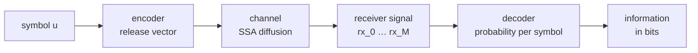

# mi-race

**Molecular communication through a diffusion channel: exact simulation, learned decoders, and a search for better symbols.**

A transmitter sends a symbol by releasing molecules. The molecules diffuse along a tube, and a receiver at the end absorbs and counts those that arrive. mi-race asks two questions:

1. How much information does the received signal carry about the symbol that was sent?
2. Which symbols carry the most information when every symbol releases the same number of molecules?

## Contents

1. [System model](#1-system-model)
2. [Encoder](#2-encoder)
3. [Channel](#3-channel)
4. [Dataset](#4-dataset)
5. [Decoders](#5-decoders)
6. [Measuring information](#6-measuring-information)
7. [Learning the codebook](#7-learning-the-codebook)
8. [Reproducibility](#8-reproducibility)
9. [Example experiment](#9-example-experiment)
10. [Validation](#10-validation)
11. [Status](#11-status)
12. [Software](#12-software)
13. [References](#references)

## 1. System model



| Symbol              | Meaning                                                      | Config key                    |
| ------------------- | ------------------------------------------------------------ | ----------------------------- |
| $N$               | number of symbols                                            | length of `encoder.symbols` |
| $K$               | release slots                                                | `encoder.n_slots`           |
| $\Delta_s$        | time between slots (s)                                       | `encoder.slot_dt`           |
| $B$               | molecules per symbol (budget)                                | `encoder.budget`            |
| $L$               | positions: compartments $0 \dots L-2$, receiver at $L-1$ | `channel.L`                 |
| $h$, $D$        | compartment width (µm), diffusion coefficient (µm²/s)     | `channel.h`, `channel.D`  |
| $\Delta t$, $T$ | receiver interval and observation time (s)                   | `channel.dt`, `channel.T` |
| $R$               | runs per symbol                                              | `data.runs_per_symbol`      |

Every symbol is simulated equally often, so the symbol $U$ is uniform and carries at most $\log_2 N$ bits.

## 2. Encoder

Symbol $u$ is a **release vector** $x_u = (x_{u,0}, \dots, x_{u,K-1})$, where $x_{u,k}$ molecules are released into compartment 0 at time

```math
t_k = k \cdot \Delta_s .
```

The rules, checked when a config is loaded:

- **Same budget:** $\sum_k x_{u,k} = B$ for every symbol, so symbols differ only in *when* they release.
- **Releases before the end:** $(K-1) \Delta_s < T$.
- **All symbols different:** two equal symbols could never be told apart.

The list of release vectors is the **codebook**. For example, the codebook of `configs/example.json` releases 50 molecules at once, at four different times:

| Symbol | Release vector                      | Release time |
| ------ | ----------------------------------- | ------------ |
| 0      | `[50, 0, 0, 0, 0, 0, 0, 0, 0, 0]` | 0.0 s        |
| 1      | `[0, 0, 0, 50, 0, 0, 0, 0, 0, 0]` | 0.3 s        |
| 2      | `[0, 0, 0, 0, 0, 0, 50, 0, 0, 0]` | 0.6 s        |
| 3      | `[0, 0, 0, 0, 0, 0, 0, 0, 0, 50]` | 0.9 s        |

## 3. Channel

### 3.1 Compartment model

```text
release ─► [ 0 ] ⇄ [ 1 ] ⇄ … ⇄ [ L-2 ] ─► receiver (L-1)
           wall                            absorbs
```

- The tube has $L-1$ compartments. The state is the number of molecules in each one, $(n_0, \dots, n_{L-2})$.
- Compartment 0 has a wall on its left, so its molecules can only jump right.
- A jump from compartment $L-2$ goes into the receiver: the molecule is absorbed, its time is recorded, and it leaves the tube.
- Molecules move independently of each other.

Each molecule jumps to each neighbouring compartment at rate

```math
\lambda = \frac{D}{h^2}
```

### 3.2 A continuous-time Markov chain

What happens next depends only on how many molecules are in each compartment now, not on the past. So the tube is a **continuous-time Markov chain**. The possible jumps and their rates are:

| Jump                                                            | Rate              | When possible             |
| --------------------------------------------------------------- | ----------------- | ------------------------- |
| compartment $i$ → $i+1$ (into the receiver if $i = L-2$) | $\lambda n_i$ | $n_i > 0$               |
| compartment $i$ → $i-1$                                    | $\lambda n_i$ | $n_i > 0$ and $i > 0$ |

A compartment with $n_i$ molecules sends one to a neighbour at rate $\lambda n_i$, because each of its molecules does so at rate $\lambda$. Let $\Lambda$ be the sum of all the rates. Two properties of a Markov chain make exact simulation possible:

- **The time to the next jump** is exponential with rate $\Lambda$, so its mean is $1/\Lambda$. The more molecules there are, the sooner something happens.
- **Which jump happens** is chosen with probability $\text{rate}/\Lambda$.

### 3.3 The stochastic simulation algorithm (SSA)

One run of one symbol (Gillespie, 1977):

1. Turn the release vector into a list of releases $(t_k, x_k)$, skipping empty slots. Add the end of the observation, $(T, 0)$, as a release of 0 molecules.
2. Start at $t = 0$ with an empty tube.
3. Before each release:
   1. List every possible jump and its rate, and sum the rates to get $\Lambda$. If the tube is empty, go to step 3.4.
   2. Draw the waiting time from an exponential distribution with mean $1/\Lambda$.
   3. If the jump would happen at or after the next release, discard it and go to step 3.4.
   4. Otherwise, pick a jump with probability $\text{rate}/\Lambda$ and move the molecule. If it entered the receiver, record the time. Go back to step 3.1.
   5. Make the release: add $x_k$ molecules to compartment 0 at time $t_k$.
4. Return the absorption times.

**Why discarding a jump at a release is exact:** the exponential distribution has no memory. Knowing that nothing happened before the release, the waiting time from the release is again exponential, now with the new rates.

### 3.4 Receiver signal

Snapshots are taken every $\Delta t$, at $t_m = m \Delta t$ for $m = 0, \dots, M$, with $M = T / \Delta t$. The signal of one run is

```math
rx_0 = 0, \qquad rx_m = \text{number of absorptions in } (t_{m-1}, t_m], \quad m = 1, \dots, M .
```

The cumulative sum $A(t_m) = rx_0 + \dots + rx_m$ is the number of molecules absorbed by $t_m$.

### 3.5 Exact check

Because molecules are independent, the mean signal can be computed exactly. A molecule released at time $s$ has been absorbed by time $t$ with probability

```math
P(t - s) = 1 - \big[e^{Q\,(t-s)}\,\mathbf 1\big]_0 ,
```

where $Q$ is the $(L-1) \times (L-1)$ matrix of jump rates between the compartments, with the receiver left out. The mean number absorbed is then

```math
\mathbb E[A(t)] = \sum_k x_k\, P(t - t_k).
```

The notebook `notebooks/channel.ipynb` compares this with the simulation (section 10).

## 4. Dataset

- Each symbol is simulated $R$ times, each run with its own random stream (section 8).
- One row per run: `symbol, rx_0, …, rx_M`, saved as CSV.
- **Stratified split:** each symbol keeps $\mathrm{round}(R \cdot f)$ runs for testing, where $f$ is `data.test_fraction`. Every decoder uses the same split.

## 5. Decoders

Each decoder learns from the training runs and gives, for each test run, a probability for every symbol. Its guess is the most likely symbol.

| Decoder | Input | Model |
|---|---|---|
| Random forest | raw counts | 200 trees |
| MLP | each $rx_m$ standardised on its own | 2 hidden layers of 128 neurons, ReLU |
| CNN | all values standardised together | 2 convolution layers (16 and 32 filters, width 5), ReLU, then a linear layer |

- The CNN standardises all values with one mean and one spread, so the signal keeps its shape over time.
- The MLP and the CNN are trained with Adam on the cross-entropy loss: 30 epochs, batches of 64, learning rate 0.001. The training runs are shuffled in a new order every epoch.
- Scalers are fitted on the training runs only.

## 6. Measuring information

All measures are computed on the test runs. $n$ is the number of test runs, and $c_{uv}$ is the confusion matrix: the number of runs of symbol $u$ that were guessed as $v$.

**Accuracy**: the share of runs guessed right.

```math
\text{accuracy} = \frac{1}{n} \sum_u c_{uu}
```

**Macro-F1**: the F1 score of each symbol, averaged over the symbols. $\text{sent}_u$ is the number of runs of symbol $u$ (row sum), and $\text{guessed}_u$ the number of runs guessed as $u$ (column sum).

```math
\text{macro-F1} = \frac{1}{N} \sum_u \frac{2 \, c_{uu}}{\text{sent}_u + \text{guessed}_u}
```

**Hard-decision MI**: the information in the guesses, in bits, with $p(u,v) = c_{uv}/n$ and $0 \log 0 = 0$.

```math
I_{\text{hard}} = \sum_{u,v} p(u,v) \log_2 \frac{p(u,v)}{p(u) \, p(v)}
```

**MI bias**: roughly how much $I_{\text{hard}}$ overestimates with only $n$ test runs (Treves and Panzeri, 1995).

```math
\text{bias} = \frac{(N-1)^2}{2 \, n \ln 2}
```

**Log-loss**: in nats, where $q_i$ is the probability the decoder gave to the symbol that was actually sent in run $i$. It is clipped at machine precision, so it never reaches 0.

```math
\text{log-loss} = -\frac{1}{n} \sum_{i=1}^{n} \ln q_i
```

**BA bound**: the information, in bits, from the probabilities.

```math
I_{\text{BA}} = \log_2 N - \frac{\text{log-loss}}{\ln 2}
```

**The Barber–Agakov (BA) bound** is a lower bound on the mutual information between symbol and signal, for any decoder (Barber and Agakov, 2003). It is the main number in mi-race:

- It uses the decoder's full probabilities, not only its guesses.
- It is only as good as the decoder is honest about its confidence. A decoder that is sure but wrong pays a lot of log-loss, so it can have high accuracy and a low bound (section 9).

## 7. Learning the codebook

The encoder search looks for a codebook with a higher BA bound by moving molecules between slots, one move at a time.

### 7.1 Scoring a codebook

`score_codebook(config, codebook, seed)`:

1. Simulate a dataset for this codebook in memory, with the given seed.
2. Split it into 5 stratified folds. Train a random forest on 4 folds and predict the fifth, so every run is scored by a forest that never saw it.
3. Raise tiny probabilities to a floor and renormalise (below).
4. Return the BA bound of these probabilities.

**The floor:**

```math
q_k = \frac{\max(p_k, \varepsilon)}{\sum_j \max(p_j, \varepsilon)}, \qquad \varepsilon = 0.0025
```

$\varepsilon$ is half of one tree's vote with 200 trees. In an early test without the floor, a single run that the forest gave probability 0 cost about 0.19 bits of the whole score.

One score takes about 1 s.

### 7.2 Moves

A move shifts a **chunk** of molecules (default 10) of one symbol from one slot to another. It is legal if the source slot holds at least a chunk, the target is a different slot, and the new symbol is not equal to another one. The budget never changes. Each step picks one legal move at random, all equally likely.

### 7.3 Accepting a move

At every step, the current codebook (parent) and the moved one (candidate) are scored **on the same new dataset**. The move is kept only if

```math
\text{score(candidate)} - \text{score(parent)} > 0.02 \text{ bits}.
```

Scoring both on the same dataset (a *paired* comparison) makes their difference much less noisy, because the symbols the move did not change get exactly the same runs. Measured spread of the difference:

| Scoring                 | sd of the difference (bits) |
| ----------------------- | --------------------------- |
| different datasets      | 0.036                       |
| same dataset, one split | 0.018                       |
| same dataset, 5 folds   | 0.010                       |

The threshold of 0.02 is about twice that spread.

### 7.4 Checking progress

- A move is kept exactly when it looked good on its own dataset, so the search's own scores flatter it.
- Progress is therefore measured on separate **check datasets**: 5 fixed datasets, the same for every codebook. A check gives the score on each of them, their mean and their spread.
- A **learning curve** checks the codebook every few steps of a search.
- **Three kinds of datasets are kept apart:**
  - *search* datasets: one per step;
  - *check* datasets: for comparing codebooks and settings;
  - *final* datasets: reserved for the reported result.

### 7.5 Results so far (check datasets)

Two starting codebooks were used: **"close"** (bursts at slots 0, 1, 2, 3) and the **hand-picked** codebook of section 2 (slots 0, 3, 6, 9). Each start had 5 search runs of 200 steps, with chunk 10 and threshold 0.02.

| Start | Start score | After 200 steps | Gain over start |
|---|---|---|---|
| close | 0.216 | 0.660 – 0.789 (mean 0.716) | +0.44 to +0.57 |
| hand-picked | 0.892 | 0.884 – 0.902 | −0.007 to +0.010 |

Scores are in bits.

- **From "close", the search climbs every time.** Most of the gain comes in the first 100 steps: the mean is 0.696 at 100 steps against 0.716 at 200.
- **Each run stops at a different level, all below the hand-picked codebook.** A likely reason: moving a whole burst far takes several moves of 10 molecules, and the first of them rarely gains enough to be kept.
- **From the hand-picked codebook, almost nothing is kept:** 14 of 1,000 moves. That is about the share noise alone lets through at this threshold, and none of them was a real gain.

## 8. Reproducibility

- One master seed (`seed` in the config) gives every job its own independent random stream: `random_stream(seed, job, *indices)`.
- Each dataset of the search gets its own master seed from `dataset_seed(seed, job, *indices)`.

| Job                     | Number  | Indices          |
| ----------------------- | ------- | ---------------- |
| simulation              | 0       | symbol, run      |
| split                   | 1       |                  |
| random forest, MLP, CNN | 2, 3, 4 |                  |
| search moves            | 5       | search run       |
| search datasets         | 6       | search run, step |
| check datasets          | 7       | $i$            |
| final datasets          | 8       | $i$            |

- A stream depends only on the seed, the job and the indices. For example, run 7 of symbol 2 is the same however many runs are simulated.
- NumPy, scikit-learn and PyTorch are seeded, and PyTorch runs in deterministic mode. "The same result" means the same machine, environment and CPU.

## 9. Example experiment

`configs/example.json` with seed 12345:

| Quantity | Symbol | Value |
|---|---|---|
| Positions (3 compartments and the receiver) | $L$ | 4 |
| Compartment width | $h$ | 1 µm |
| Diffusion coefficient | $D$ | 2 µm²/s |
| Jump rate | $\lambda$ | 2 per second |
| Observation time | $T$ | 2 s |
| Receiver interval | $\Delta t$ | 0.01 s |
| Intervals | $M$ | 200, so 201 values per run |
| Symbols | $N$ | 4 |
| Release slots | $K$ | 10 |
| Time between slots | $\Delta_s$ | 0.1 s |
| Budget | $B$ | 50 molecules |
| Runs per symbol | $R$ | 300 |
| Test runs | $n$ | 240 (test fraction 0.2) |

A molecule needs 3 s on average to reach the receiver, longer than the 2 s window. So fewer than half of the molecules arrive in time, and fewer the later they are released:

| Symbol | Exact mean absorbed by $T$ | Simulated mean |
| ------ | ---------------------------- | -------------- |
| 0      | 22.4                         | 22.3           |
| 1      | 19.0                         | 18.7           |
| 2      | 15.1                         | 15.2           |
| 3      | 11.0                         | 10.9           |

Decoders on the test runs:

| Decoder       | Accuracy        | Hard-decision MI (bits) | BA bound (bits) |
| ------------- | --------------- | ----------------------- | --------------- |
| Random forest | 0.742           | 1.022                   | **0.859** |
| MLP           | 0.779           | 1.124                   | 0.667           |
| CNN           | **0.825** | **1.194**         | 0.490           |

- The MI bias is 0.027 bits, and accuracy has a standard error of about 0.03.
- **The CNN guesses best but has the lowest BA bound.** After 30 epochs it is too sure of itself, and each confident mistake costs a lot of log-loss. This is why the encoder search uses the random forest.

## 10. Validation

The test suite (pytest) checks:

- **Config:** every rule, before anything is simulated. Unknown keys are an error.
- **Channel:**
  - the jump rates of section 3.2;
  - waiting times with mean $1/\Lambda$;
  - jumps picked in proportion to their rates;
  - every molecule is in the tube or absorbed;
  - absorptions come in time order, never before the first release;
  - for the shortest tube the mean absorption time is $1/\lambda$.
- **Signal:** the counting rule of section 3.4.
- **Decoders:** the same seed gives the same probabilities, decoders don't affect each other, and scalers are fitted on training runs only.
- **Metrics:** hand-computed cases, and agreement with scikit-learn.
- **Search:**
  - the budget is kept, and only legal moves are made, all equally likely;
  - the acceptance rule, the paired datasets and the separate check datasets are tested with controlled scores.

The notebook `notebooks/channel.ipynb` walks through the channel step by step. Its last part compares the simulated mean of $A(t)$ and of $rx_m$ with the exact formula of section 3.5, and they agree within the noise.

## 11. Status

**Built and tested:**

- configuration;
- encoder;
- SSA channel;
- dataset;
- random forest, MLP and CNN decoders;
- information measures;
- encoder search with checks and learning curves.

**In progress:** experiments with the encoder search settings.

## 12. Software

Python 3.10 or newer, with NumPy, scikit-learn and PyTorch. Everything runs on the CPU.

| Module         | Section                                |
| -------------- | -------------------------------------- |
| `config.py`  | configuration and its rules (1, 2)     |
| `encoder.py` | release vector → releases (2)         |
| `channel.py` | Markov chain, SSA, receiver signal (3) |
| `dataset.py` | simulation and split (4)               |
| `decoders/`  | random forest, MLP, CNN (5)            |
| `metrics.py` | information measures (6)               |
| `search.py`  | encoder search (7)                     |
| `streams.py` | random streams (8)                     |
| `symbols.py` | typing release vectors by hand         |

## References

- Barber, D., and Agakov, F. (2003). The IM algorithm: a variational approach to information maximization. *Advances in Neural Information Processing Systems 16*.
- Breiman, L. (2001). Random forests. *Machine Learning*, 45(1), 5–32.
- Gillespie, D. T. (1977). Exact stochastic simulation of coupled chemical reactions. *The Journal of Physical Chemistry*, 81(25), 2340–2361.
- Treves, A., and Panzeri, S. (1995). The upward bias in measures of information derived from limited data samples. *Neural Computation*, 7(2), 399–407.

## License

MIT. See [LICENSE](LICENSE).
