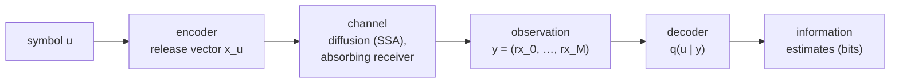

# mi-race

**Information transfer in diffusion-based molecular communication: exact stochastic simulation, learned decoders, and a search for better codebooks.**

In molecular communication, a transmitter sends a message by releasing molecules, the molecules diffuse through a medium, and a receiver detects the ones that reach it. Diffusion is slow and random, so the same message never produces the same signal twice. mi-race studies two questions:

1. **How much information does such a channel carry?** That is, the mutual information $I(U;Y)$ between the sent symbol $U$ and the received signal $Y$, in bits.
2. **How should the symbols be designed** so that this information is as large as possible, when every symbol may release the same number of molecules?

The channel is simulated exactly as a continuous-time Markov chain. The information is estimated with machine-learning decoders and the Barber–Agakov variational bound. The symbols are improved by a stochastic search that uses that bound as its objective.

> **Status:** v1 is being rebuilt from scratch. The simulator, dataset, decoders, information measures and a baseline encoder search are implemented and tested. Experiments with the search, the command-line interface and the report are in progress.

## Contents

1. [System model](#1-system-model)
2. [Encoder](#2-encoder)
3. [Channel: diffusion as a continuous-time Markov chain](#3-channel-diffusion-as-a-continuous-time-markov-chain)
4. [Dataset](#4-dataset)
5. [Decoders](#5-decoders)
6. [Measuring information](#6-measuring-information)
7. [Learning the codebook](#7-learning-the-codebook)
8. [Reproducibility](#8-reproducibility)
9. [Example experiment](#9-example-experiment)
10. [Validation](#10-validation)
11. [Status and future work](#11-status-and-future-work)
12. [Software](#12-software)
13. [References](#references)

## 1. System model



| Symbol | Meaning | Config key |
|---|---|---|
| $N$ | number of symbols | length of `encoder.symbols` |
| $K$ | number of release slots | `encoder.n_slots` |
| $\Delta_s$ | time between release slots (s) | `encoder.slot_dt` |
| $B$ | molecule budget per symbol | `encoder.budget` |
| $L$ | positions: compartments $0,\dots,L-2$ and the receiver at $L-1$ | `channel.L` |
| $h$ | compartment width (µm) | `channel.h` |
| $D$ | diffusion coefficient (µm²/s) | `channel.D` |
| $\lambda = D/h^2$ | jump rate of one molecule to one neighbour (1/s) | derived |
| $\Delta t$ | length of one receiver interval (s) | `channel.dt` |
| $T$ | observation time (s) | `channel.T` |
| $M = T/\Delta t$ | number of receiver intervals | derived |
| $R$ | simulated runs per symbol | `data.runs_per_symbol` |
| $f$ | share of runs kept for testing | `data.test_fraction` |

The symbol $U$ is uniform on $\{0,\dots,N-1\}$: every symbol is simulated equally often, so $H(U) = \log_2 N$ bits. This is the most information one symbol can carry.

## 2. Encoder

Symbol $u$ is a **release vector**

```math
\mathbf x_u = (x_{u,0}, \dots, x_{u,K-1}) \in \mathbb N^K, \qquad \sum_{k=0}^{K-1} x_{u,k} = B,
```

where $x_{u,k}$ is the number of molecules released into compartment 0 at time $t_k = k\,\Delta_s$. Each release is instantaneous. The constraints are:

- **Equal budget:** every symbol releases exactly $B$ molecules. Symbols therefore differ only in *when* they release, not in how much, so a decoder can't simply count molecules to tell them apart.
- **Release before the end:** $t_{K-1} = (K-1)\Delta_s < T$.
- **Distinct symbols:** $\mathbf x_u \neq \mathbf x_v$ for $u \neq v$. Two equal symbols could never be told apart.

The list $\mathcal C = (\mathbf x_0, \dots, \mathbf x_{N-1})$ is the **codebook**. The number of possible release vectors is the number of ways to split $B$ molecules over $K$ slots,

```math
|\mathcal X| = \binom{B+K-1}{K-1},
```

which for $B = 50$ and $K = 10$ is about $1.26 \times 10^{10}$ per symbol. The codebook space is far too large to search exhaustively (section 7).

## 3. Channel: diffusion as a continuous-time Markov chain

### 3.1 Compartment model

The medium is a one-dimensional tube divided into $L-1$ compartments of width $h$, with the receiver at the far end:

```text
release ─► [ 0 ] ⇄ [ 1 ] ⇄ … ⇄ [ L-2 ] ─► receiver (L-1)
           reflecting wall                 absorbing
```

The state of the tube at time $t$ is the number of molecules in each compartment,

```math
\mathbf n(t) = \big(n_0(t), \dots, n_{L-2}(t)\big) \in \mathbb N^{L-1},
```

and $A(t)$ counts the molecules absorbed by the receiver up to time $t$.

**Jump rate.** Each molecule jumps to each neighbouring compartment at rate $\lambda = D/h^2$. This is the standard compartment-based model of diffusion (Erban et al., 2007). A random walk with steps $\pm h$, each taken at rate $\lambda$, has mean squared displacement $\mathbb E[X(t)^2] = 2\lambda h^2 t$. One-dimensional Brownian motion has $2Dt$. The two agree when $\lambda = D/h^2$.

**Boundaries.**
- Compartment 0 has a reflecting wall on its left, so its molecules can only jump right.
- A jump from compartment $L-2$ into the receiver absorbs the molecule. It is counted once and leaves the system.

**Independence.** Molecules do not interact. Every molecule moves independently of all the others.

### 3.2 The Markov chain

Between releases, $\mathbf n(t)$ is a time-homogeneous continuous-time Markov chain (CTMC) on $\mathbb N^{L-1}$. Its possible transitions $j$, each with a state-change vector $\boldsymbol\nu_j$ and a propensity $a_j(\mathbf n)$, are:

| Transition | Change $\boldsymbol\nu_j$ | Propensity $a_j(\mathbf n)$ | For |
|---|---|---|---|
| jump right | $-\mathbf e_i + \mathbf e_{i+1}$ | $\lambda\, n_i$ | $i = 0, \dots, L-3$ |
| jump left | $-\mathbf e_i + \mathbf e_{i-1}$ | $\lambda\, n_i$ | $i = 1, \dots, L-2$ |
| absorption | $-\mathbf e_{L-2}$, and $A \leftarrow A+1$ | $\lambda\, n_{L-2}$ | |

A compartment with $n_i$ molecules sends one to a given neighbour at rate $\lambda n_i$, because each of its $n_i$ molecules does so independently at rate $\lambda$. The total propensity is

```math
a_0(\mathbf n) = \sum_j a_j(\mathbf n) = \lambda\Big(n_0 + 2\sum_{i=1}^{L-2} n_i\Big),
```

since compartment 0 has one way out and every other compartment has two.

The probability $P(\mathbf n, t)$ of being in state $\mathbf n$ at time $t$ follows the **chemical master equation**

```math
\frac{\partial P(\mathbf n,t)}{\partial t} = \sum_j \Big[a_j(\mathbf n-\boldsymbol\nu_j)\,P(\mathbf n-\boldsymbol\nu_j,t) - a_j(\mathbf n)\,P(\mathbf n,t)\Big].
```

The first term is the probability flowing *into* $\mathbf n$ and the second the probability flowing *out*.

**The Markov property.** The future of the chain depends on its past only through the present state. Two consequences make exact simulation possible (Gillespie, 1976):

1. **The waiting time is exponential.** In state $\mathbf n$, the time $\tau$ until the next transition satisfies $P(\tau > s) = e^{-a_0(\mathbf n)\,s}$.
2. **The next transition is picked in proportion to its propensity:** $P(j) = a_j(\mathbf n)/a_0(\mathbf n)$.

These two are independent, and together they give the joint density of the next event,

```math
p(\tau, j \mid \mathbf n) = a_j(\mathbf n)\, e^{-a_0(\mathbf n)\,\tau} = \underbrace{a_0(\mathbf n)\, e^{-a_0(\mathbf n)\,\tau}}_{\tau \,\sim\, \mathrm{Exp}(a_0)} \cdot \underbrace{\frac{a_j(\mathbf n)}{a_0(\mathbf n)}}_{\text{which jump}}.
```

**Releases** are deterministic events: at $t_k$ the state jumps by $n_0 \leftarrow n_0 + x_{u,k}$. Between consecutive releases the chain is time-homogeneous, with the transitions above.

### 3.3 The stochastic simulation algorithm (SSA)

Sampling from $p(\tau, j \mid \mathbf n)$ one event at a time gives trajectories with exactly the law of the master equation, with no time-step error. This is Gillespie's direct method (Gillespie, 1976, 1977). In mi-race, one run of symbol $u$ goes as follows:

1. **Schedule.** List the releases $(t_k, x_{u,k})$ for the non-empty slots, in time order, and add the end of the observation, $(T, 0)$, as a release of zero molecules.
2. **Start.** Set $t = 0$, $\mathbf n = \mathbf 0$, and start with an empty list of absorption times.
3. **For each release $(t_k, x_k)$ in order:**
   1. Compute every propensity $a_j(\mathbf n)$ and the total $a_0(\mathbf n)$. If $a_0 = 0$ (the tube is empty), go to step 3.5.
   2. Draw the waiting time $\tau \sim \mathrm{Exp}(a_0)$.
   3. If $t + \tau \geq t_k$, discard this event and go to step 3.5: the release comes first.
   4. Otherwise, pick a transition $j$ with probability $a_j/a_0$: draw $r \sim \mathrm{U}(0,1)$ and take the first $j$ whose cumulative propensity exceeds $r\,a_0$. Set $t \leftarrow t + \tau$ and $\mathbf n \leftarrow \mathbf n + \boldsymbol\nu_j$. If $j$ is an absorption, record $t$. Go back to step 3.1.
   5. Set $t \leftarrow t_k$ and release: $n_0 \leftarrow n_0 + x_k$.
4. **Return** the absorption times. They are in increasing order and all lie in $(0, T)$.

**Why discarding the event at a release is exact.** The exponential distribution is memoryless: $P(\tau > s + r \mid \tau > s) = P(\tau > r)$. Knowing that nothing happened before $t_k$, the remaining waiting time from $t_k$ is again exponential with the same rate. At $t_k$ the propensities change anyway, because of the release. So restarting the clock at $t_k$ with the new propensities gives exactly the right law.

### 3.4 Exact single-molecule theory

Because molecules are independent, the fate of each one can be computed exactly. Consider one molecule released into compartment 0. Its position is a CTMC on the transient states $\{0, \dots, L-2\}$, with the receiver as an absorbing state. Leaving the receiver out, the generator restricted to the transient states is the $(L-1)\times(L-1)$ matrix $Q$ with

```math
Q_{i,i\pm1} = \lambda \ \ \text{(for neighbours inside the tube)}, \qquad Q_{0,0} = -\lambda, \qquad Q_{i,i} = -2\lambda \ \ (i \geq 1).
```

The rows of $Q$ for compartment $L-2$ sum to $-\lambda$: that is the absorption rate. The probability that a molecule released at time $s$ has been absorbed by time $t$ is

```math
F(t - s) = 1 - \mathbf e_0^{\top}\, e^{Q\,(t-s)}\, \mathbf 1 \qquad (t > s), \qquad F(t-s) = 0 \ \ (t \leq s),
```

and its **mean absorption time** is

```math
\mathbb E[\tau_{\mathrm{abs}}] = \mathbf e_0^{\top} (-Q)^{-1} \mathbf 1 = \frac{L(L-1)}{2\lambda} = \frac{L(L-1)\,h^2}{2D}.
```

*Derivation of the mean.* Let $E_i$ be the mean time to absorption from compartment $i$, with $E_{L-1} = 0$. First-step analysis gives $E_0 = 1/\lambda + E_1$ and $E_i = 1/(2\lambda) + (E_{i-1} + E_{i+1})/2$ for $1 \le i \le L-2$. The differences $d_i = E_i - E_{i+1}$ then satisfy $d_0 = 1/\lambda$ and $d_i = d_{i-1} + 1/\lambda$, so $d_i = (i+1)/\lambda$. Summing, $E_0 = \sum_{i=0}^{L-2} (i+1)/\lambda = L(L-1)/(2\lambda)$.

### 3.5 The observation

The receiver reports how many molecules it absorbed in each interval of length $\Delta t$. With snapshot times $t_m = m\,\Delta t$ for $m = 0, \dots, M$,

```math
rx_0 = 0, \qquad rx_m = \#\{\text{absorptions in } (t_{m-1}, t_m]\}, \quad m = 1, \dots, M,
```

and the observation of one run is $Y = (rx_0, \dots, rx_M) \in \mathbb N^{M+1}$. The cumulative count is $A(t_m) = \sum_{i \le m} rx_i \le B$.

**The exact distribution of $Y$.** A molecule released at time $s$ is absorbed in interval $m$ with probability

```math
\pi_m(s) = F(t_m - s) - F(t_{m-1} - s), \qquad m = 1, \dots, M,
```

and is not absorbed by $T$ with probability $\pi_\infty(s) = 1 - F(T - s)$. Molecules are independent, so the $x_{u,k}$ molecules of one release spread over the intervals as a multinomial, and $Y$ is a sum of independent multinomials, one for each release:

```math
Y \mid U = u \;=\; \sum_{k} Z_k, \qquad (Z_k, \text{not absorbed}) \sim \mathrm{Multinomial}\big(x_{u,k};\ \pi_1(t_k), \dots, \pi_M(t_k), \pi_\infty(t_k)\big).
```

In particular:

```math
\mathbb E[rx_m \mid u] = \sum_k x_{u,k}\, \pi_m(t_k), \qquad A(T) \mid u \sim \sum_k \mathrm{Binomial}\big(x_{u,k},\, F(T - t_k)\big).
```

These formulas are the reference against which the simulator is checked (section 10). The SSA is kept as the general method because it stays valid when molecules interact, for example through reactions, degradation or receptor saturation, where independence and these closed forms no longer hold.

## 4. Dataset

For each symbol $u$ and run $r = 0, \dots, R-1$, one SSA run gives one observation $\mathbf y_{u,r}$. The dataset has $N R$ rows of the form $(u, rx_0, \dots, rx_M)$. Every run uses its own independent random stream (section 8).

The dataset is split once into training and test runs, **stratified by symbol**: each symbol keeps $\mathrm{round}(R f)$ runs for testing, chosen at random, so $n_{\text{test}} = N\,\mathrm{round}(Rf)$. Every decoder uses the same split, and the test runs are never used for training or for fitting scalers.

## 5. Decoders

A decoder is a probabilistic classifier $q_\theta(u \mid \mathbf y)$ that approximates the posterior

```math
p(u \mid \mathbf y) = \frac{p(\mathbf y \mid u)}{\sum_{v} p(\mathbf y \mid v)} \qquad \text{(uniform prior).}
```

Its hard decision is $\hat u = \arg\max_u q_\theta(u \mid \mathbf y)$.

| Decoder | Input scaling | Model | Training |
|---|---|---|---|
| Random forest (Breiman, 2001) | none, raw counts | 200 fully grown trees; the probability is the average over trees of the class shares in the leaf a run falls into, close to the share of trees voting for each symbol | bootstrap samples and random feature subsets |
| MLP | each $rx_m$ standardised on its own | fully connected layers (128, 128) with ReLU, then a softmax over symbols | Adam, cross-entropy, 30 epochs, batch 64, learning rate $10^{-3}$ |
| CNN | all values standardised with one mean and one spread, so the signal keeps its shape over time | 1-D convolutions along time (16 and 32 filters, width 5, "same" padding, ReLU), then a linear layer and softmax | as the MLP |

The networks minimise the empirical cross-entropy $-\frac1n \sum_i \ln q_\theta(u_i \mid \mathbf y_i)$ on the training runs. By section 6.4, this is the same as maximising the Barber–Agakov bound on the training data. On new data a network can become *overconfident*: it puts almost all probability on one symbol, and is sometimes wrong. That costs little accuracy but a lot of cross-entropy.

## 6. Measuring information

### 6.1 The target

```math
I(U;Y) = H(U) - H(U \mid Y) = \sum_{u}\int p(u, \mathbf y)\, \log_2 \frac{p(u \mid \mathbf y)}{p(u)}\, d\mathbf y \;\le\; \log_2 N.
```

$Y$ has $M+1$ dimensions ($201$ in the example), so estimating $p(\mathbf y \mid u)$ from samples, and from it $I(U;Y)$, is not feasible directly. mi-race reports decoder-based quantities instead, all computed on the held-out test runs.

### 6.2 Accuracy and macro-F1

```math
\mathrm{acc} = \frac1n \sum_{i=1}^{n} \mathbb 1[\hat u_i = u_i], \qquad
\mathrm{F1}_u = \frac{2\,TP_u}{2\,TP_u + FP_u + FN_u}, \qquad
\text{macro-F1} = \frac1N \sum_u \mathrm{F1}_u.
```

### 6.3 Hard-decision mutual information

From the confusion matrix $c_{uv}$ (sent $u$, guessed $v$), with $\hat p(u,v) = c_{uv}/n$ and its marginals,

```math
\hat I(U;\hat U) = \sum_{u,v} \hat p(u,v)\, \log_2 \frac{\hat p(u,v)}{\hat p(u)\,\hat p(v)}, \qquad 0 \log 0 = 0.
```

- **A lower bound in principle.** By the data-processing inequality, $I(U;\hat U) \le I(U;Y)$, since $\hat U$ is computed from $Y$. Taking a hard decision throws away the decoder's confidence.
- **Biased upwards in practice.** The plug-in estimate from $n$ samples overestimates by about $(N-1)^2 / (2\,n \ln 2)$ bits (Treves and Panzeri, 1995). mi-race reports this bias next to the estimate. For $N = 4$ and $n = 240$ it is 0.027 bits.

### 6.4 The Barber–Agakov bound

For **any** distribution $q(u \mid \mathbf y)$ (Barber and Agakov, 2003):

```math
I(U;Y) \;\ge\; H(U) + \mathbb E\big[\log_2 q(U \mid Y)\big] \;=\; \log_2 N - \mathrm{CE}(q).
```

*Proof.* $H(U \mid Y) = \mathbb E[-\log_2 p(U \mid Y)]$, and

```math
\mathbb E[-\log_2 q(U \mid Y)] - H(U \mid Y) = \mathbb E_{Y}\Big[\mathrm{KL}\big(p(\cdot \mid Y)\,\big\|\,q(\cdot \mid Y)\big)\Big] \ge 0.
```

So the gap of the bound is exactly the expected KL divergence between the true posterior and the decoder: the bound is tight when the decoder is the true posterior.

On the test runs it is estimated by

```math
\hat I_{\mathrm{BA}} = \log_2 N - \frac{1}{n \ln 2} \sum_{i=1}^{n} -\ln q(u_i \mid \mathbf y_i),
```

where the sum, divided by $n$, is the log-loss in nats.

- **Unbiased for the bound.** The decoder was trained on other runs, so for that fixed decoder $\hat I_{\mathrm{BA}}$ is an unbiased estimate of a valid lower bound. Unlike the plug-in estimate of 6.3, it has no upward bias. This is why it is the main number, and the objective of the encoder search.
- **It needs calibration.** An overconfident decoder pays $-\log_2 q$ for every confident mistake, so its bound can be low, or even negative, while its accuracy is high (section 9).
- **Zero probabilities** are clipped at machine precision ($2.2 \times 10^{-16}$), so a single run costs at most about 52 bits.

## 7. Learning the codebook

### 7.1 The problem

```math
\mathcal C^\star = \arg\max_{\mathcal C}\; I_{\mathrm{BA}}(\mathcal C)
\quad \text{subject to} \quad \sum_k x_{u,k} = B, \ \ x_{u,k} \in \mathbb N, \ \ \mathbf x_u \ne \mathbf x_v .
```

The space is discrete and huge (about $10^{40}$ codebooks for $N = 4$, $K = 10$, $B = 50$). The objective can only be estimated by simulation, with noise, and the simulator gives no gradient. mi-race therefore uses a **stochastic local search** (a hill climb with a noisy objective). This is the baseline; gradient-based joint training of encoder and decoder is a later option.

### 7.2 Scoring a codebook

Given a codebook $\mathcal C$ and a dataset seed $s$, the score $\hat J_s(\mathcal C)$ is computed as follows:

1. Simulate a dataset of $N R$ runs in memory, with master seed $s$.
2. Split it into 5 stratified folds. For each fold, train a random forest on the other 4 folds and predict the held-out fold. Every run is then scored by a forest that never saw it, and all $N R$ runs are used, not just a test share.
3. **Floor** the probabilities:

   ```math
   \tilde q_k = \frac{\max(q_k, \varepsilon)}{\sum_j \max(q_j, \varepsilon)}, \qquad \varepsilon = 0.0025 = \tfrac12 \cdot \tfrac{1}{200}\ \text{(half of one tree's vote)}.
   ```

   $\tilde q$ is still a probability distribution, so the bound of 6.4 stays valid. A forest gives exact zeros whenever no tree votes for the sent symbol. Unfloored, one such run costs about 52 bits, which on 240 test runs moves the score by about 0.2 bits and can steer the search on its own. With the floor, one confident mistake costs at most $\log_2\big((1 + (N-1)\varepsilon)/\varepsilon\big) \approx 8.7$ bits.
4. Return $\hat I_{\mathrm{BA}}$ of the floored probabilities.

The random forest gives the feedback because it is fast (about 1 s per score), and its bound did not collapse from overconfidence the way the networks' did.

### 7.3 Moves

A move $(u, k, k')$ shifts $c$ molecules (default $c = 10$) of symbol $u$ from slot $k$ to slot $k'$:

```math
x'_{u,k} = x_{u,k} - c, \qquad x'_{u,k'} = x_{u,k'} + c .
```

It is legal if $x_{u,k} \ge c$, $k' \ne k$, and the new vector is not equal to another symbol. The budget is kept by construction. Each step picks one legal move uniformly at random.

### 7.4 Accepting a move: paired comparisons

At step $t$ of search run $r$, the parent $\mathcal C$ and the candidate $\mathcal C'$ are scored **on the same new dataset seed** $s_{r,t}$, and the move is kept only if

```math
\Delta_t = \hat J_{s_{r,t}}(\mathcal C') - \hat J_{s_{r,t}}(\mathcal C) > \theta, \qquad \theta = 0.02 \text{ bits}.
```

- **Common random numbers.** With the same seed, the symbols the move did not change get identical runs, and the folds and forests are seeded the same way. The two scores are therefore strongly correlated, and the variance of their difference,

  ```math
  \mathrm{Var}(\Delta) = \sigma_{\mathcal C'}^2 + \sigma_{\mathcal C}^2 - 2\rho\,\sigma_{\mathcal C'}\sigma_{\mathcal C},
  ```

  shrinks.
- **Measured noise** of the difference for an almost neutral move, over 20 seeds:

  | Scoring | sd of $\Delta$ (bits) |
  |---|---|
  | different seeds | 0.036 |
  | same seed, one train/test split | 0.018 ($\rho \approx 0.73$) |
  | same seed, 5-fold | 0.010 |

- **The threshold.** $\theta$ is about twice the sd of $\Delta$, so a move that changes nothing is kept only about 2 % of the time (normal approximation).

### 7.5 Measuring progress without fooling ourselves

A move is kept exactly when its $\Delta_t$ happened to be large. So the search's own scores overstate its gains; this is the *winner's curse*. Progress is therefore measured on separate datasets, and three kinds of datasets are kept apart:

| Datasets | Used for | Seeds |
|---|---|---|
| **search** | paired comparisons inside a search run | one per (run, step) |
| **check** | comparing codebooks and search settings, learning curves | a fixed set $i = 0, \dots, 4$, the same for every codebook |
| **final** | the reported result, used once, after every choice is frozen | separate |

- A **check** scores a codebook on all check datasets. Two codebooks can then be compared dataset by dataset (paired), with the mean and spread of the difference.
- A **learning curve** checks the codebook every few steps of a search.
- Everything that influences a choice (chunk size, number of steps, threshold) counts as development. Only the final datasets give reported numbers.

### 7.6 First results (development)

- **Winner's curse in practice:** one move kept with $\Delta = +0.020$ bits on its search dataset gained only $+0.006 \pm 0.005$ on the check datasets.
- **The search climbs from a poor start.** Starting from four bursts in neighbouring slots (0, 1, 2, 3), a 40-step search improved the check score from **0.216 to 0.482 bits**. The paired gain was $+0.266$ bits, with an sd of 0.021 over 5 check datasets. The search moved the late symbols' molecules later in time, away from the early ones.
- **The hand-picked codebook of section 9 scores 0.892 bits.**

Experiments with several search runs, other settings and a transfer check to the CNN are in progress.

## 8. Reproducibility

One master seed $s$ drives all randomness. Each job gets its own independent stream, derived with NumPy's `SeedSequence` from the seed, a fixed job number and the job's indices:

| Job | Number | Indices |
|---|---|---|
| simulation | 0 | symbol $u$, run $r$ |
| split | 1 | |
| random forest | 2 | |
| MLP | 3 | |
| CNN | 4 | |
| search moves | 5 | search run |
| search datasets | 6 | search run, step |
| check datasets | 7 | $i$ |
| final datasets | 8 | $i$ |

- A stream depends only on the seed, its job and its indices. So run $r$ of symbol $u$ is the same however many runs are simulated, and adding a decoder or a search step doesn't change any other number.
- NumPy, scikit-learn and PyTorch are all seeded, and PyTorch runs in deterministic mode.
- "The same result" means the same machine, the same software environment, and the CPU.

## 9. Example experiment

The reference configuration (`configs/example.json`, seed 12345):

| Parameter | Value | Derived |
|---|---|---|
| Tube | $L = 4$ (3 compartments), $h = 1$ µm, $D = 2$ µm²/s | $\lambda = 2$ s⁻¹; mean absorption time $L(L-1)/(2\lambda) = 3$ s |
| Observation | $T = 2$ s, $\Delta t = 0.01$ s | $M = 200$, so 201 values per run |
| Encoder | $K = 10$ slots, $\Delta_s = 0.1$ s, $B = 50$, $N = 4$ | $H(U) = 2$ bits |
| Data | $R = 300$ runs per symbol, $f = 0.2$ | $n_{\text{test}} = 240$ |

The codebook releases all $B$ molecules at once, at four different times:

| Symbol | Release | $F(T - t_k)$ | Expected absorbed by $T$ | Simulated mean (300 runs) |
|---|---|---|---|---|
| 0 | 50 at $t = 0.0$ s | 0.448 | 22.4 | 22.3 |
| 1 | 50 at $t = 0.3$ s | 0.379 | 19.0 | 18.7 |
| 2 | 50 at $t = 0.6$ s | 0.303 | 15.1 | 15.2 |
| 3 | 50 at $t = 0.9$ s | 0.220 | 11.0 | 10.9 |

The mean absorption time (3 s) is longer than the observation window (2 s), so fewer than half of the molecules arrive in time, and fewer the later they are released. The decoders can use both *when* molecules arrive and *how many* arrive.

**Decoders on the test runs** (same split for all, default settings):

| Decoder | Accuracy | Macro-F1 | Hard-decision MI (bits) | BA bound (bits) |
|---|---|---|---|---|
| Random forest | 0.742 | 0.740 | 1.022 | **0.859** |
| MLP | 0.779 | 0.783 | 1.124 | 0.667 |
| CNN | **0.825** | **0.827** | **1.194** | 0.490 |

- The hard-decision MI carries an upward bias of about 0.027 bits.
- Accuracy has a standard error of about 0.03 at $n = 240$.

**Reading.** The CNN is the best classifier but gives the *lowest* BA bound. After 30 epochs it is overconfident, and each confident mistake costs many bits of cross-entropy. The forest's averaged votes are better calibrated. This is why the forest gives the feedback of the encoder search, and why calibration (temperature scaling, Guo et al., 2017) is planned before the networks' bounds are reported. All of these numbers are far from the 2-bit ceiling: the channel is slow and noisy, and the codebook is hand-picked.

## 10. Validation

The code has a test suite (pytest). What it checks, by part:

- **Configuration:** every rule is checked before anything is simulated: types and ranges, the budget, distinct symbols, releases before $T$, and a whole number of intervals. Unknown keys are an error.
- **Channel:**
  - the propensities of section 3.2;
  - waiting times with mean $1/a_0$;
  - transitions picked in proportion to their propensities;
  - conservation: every molecule is in the tube or absorbed;
  - absorptions in time order, never before the first release;
  - mean absorption time $1/\lambda$ for the shortest tube ($L = 2$).
- **Observation:** the counting rule of section 3.5, and $A(t_m)$ equals the number of absorptions up to $t_m$.
- **Decoders:**
  - the same seed gives the same probabilities;
  - decoders do not affect each other's numbers;
  - scalers are fitted on the training runs and applied unchanged to other runs.
- **Metrics:** hand-computed cases for every formula of section 6, and agreement with scikit-learn.
- **Search:**
  - the budget is kept, symbols stay distinct, and only legal moves are made;
  - every legal move is equally likely;
  - the acceptance rule, the paired seeds and the separation of search and check datasets are checked with controlled (fake) scores, so they can be verified exactly.

The notebook `notebooks/channel.ipynb` walks through the channel step by step. It compares the simulated mean of $A(t)$ and of $rx_m$, over 300 runs per symbol, with the exact formulas of section 3.5. They agree within the standard error.

## 11. Status and future work

**Done:**
- configuration and validation;
- the SSA channel;
- the dataset;
- the three decoders;
- the information measures;
- the baseline encoder search with development checks.

**In progress:**
- search experiments: several runs, the choice of chunk size, number of steps and threshold, and transfer to the CNN;
- the final evaluation on held-out final datasets;
- the command-line interface and report.

**Planned or open:**
- calibration of the networks (temperature scaling) so their BA bounds can be reported;
- hyperparameter tuning of the decoders by cross-validation;
- gradient-based joint training of encoder and decoder;
- **an exact reference for $I(U;Y)$:** since $Y \mid U$ is a sum of independent multinomials (section 3.5), $p(\mathbf y \mid u)$ can be computed. That would allow a Monte Carlo estimate of the true mutual information, against which the decoder-based bounds can be validated.

## 12. Software

- Python 3.10 or newer, with NumPy, scikit-learn and PyTorch. Install as a package in editable mode with pip.
- The optional extras are `dev` (pytest) and `notebook` (ipykernel, matplotlib, SciPy).
- All computation runs on the CPU.

| Module | Content |
|---|---|
| `config.py` | loading and validating a configuration |
| `encoder.py` | release vector → release schedule (section 2) |
| `channel.py` | the CTMC and the SSA (section 3) |
| `dataset.py` | simulation of datasets, the stratified split (section 4) |
| `decoders/` | random forest, MLP, CNN (section 5) |
| `metrics.py` | the information measures (section 6) |
| `search.py` | the encoder search (section 7) |
| `streams.py` | the random streams (section 8) |
| `symbols.py` | interactive entry of release vectors |

## References

- Barber, D., and Agakov, F. (2003). The IM algorithm: a variational approach to information maximization. *Advances in Neural Information Processing Systems 16*.
- Breiman, L. (2001). Random forests. *Machine Learning*, 45(1), 5–32.
- Cover, T. M., and Thomas, J. A. (2006). *Elements of Information Theory* (2nd ed.). Wiley.
- Erban, R., Chapman, J., and Maini, P. (2007). A practical guide to stochastic simulations of reaction–diffusion processes. arXiv:0704.1908.
- Farsad, N., Yilmaz, H. B., Eckford, A., Chae, C.-B., and Guo, W. (2016). A comprehensive survey of recent advancements in molecular communication. *IEEE Communications Surveys & Tutorials*, 18(3), 1887–1919.
- Gillespie, D. T. (1976). A general method for numerically simulating the stochastic time evolution of coupled chemical reactions. *Journal of Computational Physics*, 22(4), 403–434.
- Gillespie, D. T. (1977). Exact stochastic simulation of coupled chemical reactions. *The Journal of Physical Chemistry*, 81(25), 2340–2361.
- Guo, C., Pleiss, G., Sun, Y., and Weinberger, K. Q. (2017). On calibration of modern neural networks. *Proceedings of the 34th International Conference on Machine Learning*.
- Norris, J. R. (1997). *Markov Chains*. Cambridge University Press.
- Treves, A., and Panzeri, S. (1995). The upward bias in measures of information derived from limited data samples. *Neural Computation*, 7(2), 399–407.

## License

MIT. See [LICENSE](LICENSE).
