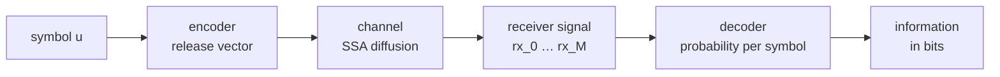

# mi-race

**Molecular communication through a diffusion channel: exact simulation, learned decoders, and a search for better symbols.**

A transmitter sends a symbol by releasing molecules. The molecules diffuse along a tube, and a receiver at the end absorbs and counts those that arrive. mi-race asks two questions:

1. How much information does the received signal carry about the symbol that was sent?
2. Which symbols carry the most information when every symbol releases the same number of molecules?

## Quick start

```bash
pip install -e .                 # from this folder: Python 3.10 or newer
mi-race                          # opens the mi-race shell; 'help' lists the commands
```

In the shell, a first experiment takes four commands:

```text
new my-channel                   # asks for the settings, Enter keeps each default
simulate configs/my-channel.json # the dataset: every symbol through the channel
run configs/my-channel.json      # trains and scores the decoders
report configs/my-channel.json   # one HTML page with every result
```

Section 12 explains every command.

## Contents

1. [System model](#1-system-model)
2. [Encoder](#2-encoder)
3. [Channel](#3-channel)
4. [Dataset](#4-dataset)
5. [Decoders](#5-decoders)
6. [Measuring information](#6-measuring-information)
7. [Learning the codebook](#7-learning-the-codebook)
8. [Reproducibility](#8-reproducibility)
9. [Example experiment](#9-example-experiment)
10. [Validation](#10-validation)
11. [Status](#11-status)
12. [Using mi-race](#12-using-mi-race)
13. [Software](#13-software)
14. [References](#references)

## 1. System model



| Symbol              | Meaning                                                      | Config key                    |
| ------------------- | ------------------------------------------------------------ | ----------------------------- |
| $N$               | number of symbols                                            | length of `encoder.symbols` |
| $K$               | release slots                                                | `encoder.n_slots`           |
| $\Delta_s$        | time between slots (s)                                       | `encoder.slot_dt`           |
| $B$               | molecules per symbol (budget)                                | `encoder.budget`            |
| $L$               | positions: compartments $0 \dots L-2$, receiver at $L-1$ | `channel.L`                 |
| $h$, $D$        | compartment width (µm), diffusion coefficient (µm²/s)     | `channel.h`, `channel.D`  |
| $\Delta t$, $T$ | receiver interval and observation time (s)                   | `channel.dt`, `channel.T` |
| $R$               | runs per symbol                                              | `data.runs_per_symbol`      |

Every symbol is simulated equally often, so the symbol $U$ is uniform and carries at most $\log_2 N$ bits.

## 2. Encoder

Symbol $u$ is a **release vector** $x_u = (x_{u,0}, \dots, x_{u,K-1})$, where $x_{u,k}$ molecules are released into compartment 0 at time

```math
t_k = k \cdot \Delta_s .
```

The rules, checked when a config is loaded:

- **Same budget:** $\sum_k x_{u,k} = B$ for every symbol, so symbols differ only in *when* they release.
- **Releases before the end:** $(K-1) \Delta_s < T$.
- **All symbols different:** two equal symbols could never be told apart.

The list of release vectors is the **codebook**. For example, the codebook of `configs/example.json` releases 50 molecules at once, at four different times:

| Symbol | Release vector                      | Release time |
| ------ | ----------------------------------- | ------------ |
| 0      | `[50, 0, 0, 0, 0, 0, 0, 0, 0, 0]` | 0.0 s        |
| 1      | `[0, 0, 0, 50, 0, 0, 0, 0, 0, 0]` | 0.3 s        |
| 2      | `[0, 0, 0, 0, 0, 0, 50, 0, 0, 0]` | 0.6 s        |
| 3      | `[0, 0, 0, 0, 0, 0, 0, 0, 0, 50]` | 0.9 s        |

## 3. Channel

### 3.1 Compartment model

```text
release ─► [ 0 ] ⇄ [ 1 ] ⇄ … ⇄ [ L-2 ] ─► receiver (L-1)
           wall                            absorbs
```

- The tube has $L-1$ compartments. The state is the number of molecules in each one, $(n_0, \dots, n_{L-2})$.
- Compartment 0 has a wall on its left, so its molecules can only jump right.
- A jump from compartment $L-2$ goes into the receiver: the molecule is absorbed, its time is recorded, and it leaves the tube.
- Molecules move independently of each other.

Each molecule jumps to each neighbouring compartment at rate

```math
\lambda = \frac{D}{h^2}
```

### 3.2 A continuous-time Markov chain

What happens next depends only on how many molecules are in each compartment now, not on the past. So the tube is a **continuous-time Markov chain**. The possible jumps and their rates are:

| Jump                                                            | Rate              | When possible             |
| --------------------------------------------------------------- | ----------------- | ------------------------- |
| compartment $i$ → $i+1$ (into the receiver if $i = L-2$) | $\lambda n_i$ | $n_i > 0$               |
| compartment $i$ → $i-1$                                    | $\lambda n_i$ | $n_i > 0$ and $i > 0$ |

A compartment with $n_i$ molecules sends one to a neighbour at rate $\lambda n_i$, because each of its molecules does so at rate $\lambda$. Let $\Lambda$ be the sum of all the rates. Two properties of a Markov chain make exact simulation possible:

- **The time to the next jump** is exponential with rate $\Lambda$, so its mean is $1/\Lambda$. The more molecules there are, the sooner something happens.
- **Which jump happens** is chosen with probability $\text{rate}/\Lambda$.

### 3.3 The stochastic simulation algorithm (SSA)

One run of one symbol (Gillespie, 1977):

1. Turn the release vector into a list of releases $(t_k, x_k)$, skipping empty slots. Add the end of the observation, $(T, 0)$, as a release of 0 molecules.
2. Start at $t = 0$ with an empty tube.
3. Before each release:
   1. List every possible jump and its rate, and sum the rates to get $\Lambda$. If the tube is empty, go to step 3.4.
   2. Draw the waiting time from an exponential distribution with mean $1/\Lambda$.
   3. If the jump would happen at or after the next release, discard it and go to step 3.4.
   4. Otherwise, pick a jump with probability $\text{rate}/\Lambda$ and move the molecule. If it entered the receiver, record the time. Go back to step 3.1.
   5. Make the release: add $x_k$ molecules to compartment 0 at time $t_k$.
4. Return the absorption times.

**Why discarding a jump at a release is exact:** the exponential distribution has no memory. Knowing that nothing happened before the release, the waiting time from the release is again exponential, now with the new rates.

### 3.4 Receiver signal

Snapshots are taken every $\Delta t$, at $t_m = m \Delta t$ for $m = 0, \dots, M$, with $M = T / \Delta t$. The signal of one run is

```math
rx_0 = 0, \qquad rx_m = \text{number of absorptions in } (t_{m-1}, t_m], \quad m = 1, \dots, M .
```

The cumulative sum $A(t_m) = rx_0 + \dots + rx_m$ is the number of molecules absorbed by $t_m$.

### 3.5 Exact check

Because molecules are independent, the mean signal can be computed exactly. A molecule released at time $s$ has been absorbed by time $t$ with probability

```math
P(t - s) = 1 - \big[e^{Q\,(t-s)}\,\mathbf 1\big]_0 ,
```

where $Q$ is the $(L-1) \times (L-1)$ matrix of jump rates between the compartments, with the receiver left out. The mean number absorbed is then

```math
\mathbb E[A(t)] = \sum_k x_k\, P(t - t_k).
```

The notebook `notebooks/channel.ipynb` compares this with the simulation (section 10).

## 4. Dataset

- Each symbol is simulated $R$ times, each run with its own random stream (section 8).
- One row per run: `symbol, rx_0, …, rx_M`, saved as CSV.
- **Stratified split:** each symbol keeps $\mathrm{round}(R \cdot f)$ runs for testing, where $f$ is `data.test_fraction`. Every decoder uses the same split.

## 5. Decoders

Each decoder learns from the training runs and gives, for each test run, a probability for every symbol. Its guess is the most likely symbol.

| Decoder | Input | Model |
|---|---|---|
| Random forest | raw counts | 200 trees |
| MLP | each $rx_m$ standardised on its own | 2 hidden layers of 128 neurons, ReLU |
| CNN | all values standardised together | 2 convolution layers (16 and 32 filters, width 5), ReLU, then a linear layer |

- The CNN standardises all values with one mean and one spread, so the signal keeps its shape over time.
- The MLP and the CNN are trained with Adam on the cross-entropy loss: 30 epochs, batches of 64, learning rate 0.001. The training runs are shuffled in a new order every epoch.
- Scalers are fitted on the training runs only.
- Any decoder can also be **rescaled** with one temperature, fitted on held-back training runs (section 6).

## 6. Measuring information

All measures are computed on the test runs. $n$ is the number of test runs, and $c_{uv}$ is the confusion matrix: the number of runs of symbol $u$ that were guessed as $v$.

**Accuracy**: the share of runs guessed right.

```math
\text{accuracy} = \frac{1}{n} \sum_u c_{uu}
```

**Macro-F1**: the F1 score of each symbol, averaged over the symbols. $\text{sent}_u$ is the number of runs of symbol $u$ (row sum), and $\text{guessed}_u$ the number of runs guessed as $u$ (column sum).

```math
\text{macro-F1} = \frac{1}{N} \sum_u \frac{2 \, c_{uu}}{\text{sent}_u + \text{guessed}_u}
```

**Hard-decision MI**: the information in the guesses, in bits, with $p(u,v) = c_{uv}/n$ and $0 \log 0 = 0$.

```math
I_{\text{hard}} = \sum_{u,v} p(u,v) \log_2 \frac{p(u,v)}{p(u) \, p(v)}
```

**MI bias**: roughly how much $I_{\text{hard}}$ overestimates with only $n$ test runs (Treves and Panzeri, 1995).

```math
\text{bias} = \frac{(N-1)^2}{2 \, n \ln 2}
```

**Log-loss**: in nats, where $q_i$ is the probability the decoder gave to the symbol that was actually sent in run $i$. It is clipped at machine precision, so it never reaches 0.

```math
\text{log-loss} = -\frac{1}{n} \sum_{i=1}^{n} \ln q_i
```

**BA bound**: the information, in bits, from the probabilities.

```math
I_{\text{BA}} = \log_2 N - \frac{\text{log-loss}}{\ln 2}
```

**The Barber–Agakov (BA) bound** is a lower bound on the mutual information between symbol and signal, for any decoder (Barber and Agakov, 2003). It is the main number in mi-race:

- It uses the decoder's full probabilities, not only its guesses.
- It is only as good as the decoder is honest about its confidence. A decoder that is sure but wrong pays a lot of log-loss, so it can have high accuracy and a low bound (section 9). Temperature rescaling corrects this.

**Temperature rescaling** (Guo et al., 2017) replaces a decoder's probabilities $p_k$ by

```math
q_k = \frac{p_k^{1/T}}{\sum_j p_j^{1/T}}
```

- $T > 1$ softens an overconfident decoder, $T < 1$ sharpens an underconfident one, and $T = 1$ changes nothing. For the networks it is the same as dividing their outputs by $T$ before the softmax.
- The order of the probabilities is kept, so the guess never changes.
- **Fitting $T$:** 20% of each symbol's training runs are held back, and the decoder trains on the rest. $T$ is the value with the lowest log-loss on the held-back runs, out of 401 values spaced evenly on a log scale from 0.05 to 20 (1 included).
- The test runs are never used to fit $T$.

## 7. Learning the codebook

The encoder search looks for a codebook with a higher BA bound by moving molecules between slots, one move at a time.

### 7.1 Scoring a codebook

`score_codebook(config, codebook, seed, decoder, rescaled)`:

1. Simulate a dataset for this codebook in memory, with the given seed.
2. Split it into 5 stratified folds. Train the decoder on 4 folds and predict the fifth, so every run is scored by a decoder that never saw it. If rescaled, each fold's decoder also fits its own temperature on a fifth of its training runs.
3. Raise tiny probabilities to a floor and renormalise (below).
4. Return the BA bound of these probabilities.

The decoder is the random forest by default, or the MLP or the CNN. The final search uses the rescaled MLP (section 7.5).

**The floor:**

```math
q_k = \frac{\max(p_k, \varepsilon)}{\sum_j \max(p_j, \varepsilon)}, \qquad \varepsilon = 0.0025
```

$\varepsilon$ is half of one tree's vote with 200 trees. In an early test without the floor, a single run that the forest gave probability 0 cost about 0.19 bits of the whole score.

One score takes about 1 s with the forest or the MLP, and about 20 s with the CNN.

### 7.2 Moves

A move shifts a **chunk** of molecules (default 10) of one symbol from one slot to another. It is legal if the source slot holds at least a chunk, the target is a different slot, and the new symbol is not equal to another one. The budget never changes. Each step picks one legal move at random, all equally likely. With a chunk of 50, the whole budget, a move relocates a symbol's whole burst.

### 7.3 Accepting a move

At every step, the current codebook (parent) and the moved one (candidate) are scored **on the same new dataset**. The move is kept only if

```math
\text{score(candidate)} - \text{score(parent)} > \theta .
```

Scoring both on the same dataset (a *paired* comparison) makes their difference much less noisy, because the symbols the move did not change get exactly the same runs. Measured spread of the difference for an almost neutral move (10 molecules of one symbol moved by one slot):

| Decoder      | Scoring                 | sd of the difference (bits) |
| ------------ | ----------------------- | --------------------------- |
| forest       | different datasets      | 0.036                       |
| forest       | same dataset, one split | 0.018                       |
| forest       | same dataset, 5 folds   | 0.010                       |
| rescaled MLP | same dataset, 5 folds   | 0.026                       |

The threshold $\theta$ is about twice the spread of the decoder that scores: 0.02 bits for the forest and 0.05 for the rescaled MLP.

### 7.4 Checking progress

- A move is kept exactly when it looked good on its own dataset, so the search's own scores flatter it.
- Progress is therefore measured on separate **check datasets**: 5 fixed datasets, the same for every codebook. A check gives the score on each of them, their mean and their spread.
- A **learning curve** checks the codebook every few steps of a search.
- **Three kinds of datasets are kept apart:**
  - *search* datasets: one per step;
  - *check* datasets: for comparing codebooks and settings;
  - *final* datasets: used once, for the reported result (section 7.6).

### 7.5 Choosing the settings (check datasets)

Every choice was made on search and check datasets. Two starting codebooks were used: **"close"** (bursts at slots 0, 1, 2, 3) and the **hand-picked** codebook of section 2 (slots 0, 3, 6, 9). Each setting had 5 search runs.

| Feedback | Chunk | $\theta$ | From close (100 steps) | Hand-picked |
|---|---|---|---|---|
| forest | 10 | 0.02 | 0.632 – 0.755 | 0.892 |
| forest | 50 | 0.02 | 0.900 – 0.914 | 0.892 |
| rescaled MLP | 50 | 0.05 | 1.132 – 1.214 | 1.202 |

Check scores in bits, each under the search's own feedback.

- **Small moves get stuck.** With chunk 10, every run from close climbed but stopped below hand-picked. Moving a whole burst takes 5 moves of 10, and the first of them rarely gains enough to be kept.
- **The forest's preference did not hold for the other decoders.**
  - With chunk 50, 4 of 5 runs ended at bursts in slots 0, 1, 6, 9, above hand-picked on the forest's bound.
  - But this codebook makes symbols 0 and 1 almost impossible to tell apart. Under the rescaled MLP and CNN it is 0.24–0.30 bits worse than hand-picked.
  - The forest is underconfident ($T \approx 0.45$), and its bound favoured a codebook where being unsure is right.
- **So the feedback must be calibrated.** With the rescaled MLP as feedback:
  - 3 of 5 runs from close found the hand-picked codebook itself, with the symbols numbered differently;
  - from hand-picked, none of 1,000 moves of a whole or a half burst was kept.
- **Frozen settings:** rescaled MLP feedback, chunk 50, $\theta = 0.05$, 100 steps.

### 7.6 Final result (final datasets)

The frozen search was run on fresh random streams, 5 runs from each start. Then every codebook involved was evaluated once on 10 final datasets never used before: one stratified split each (240 test runs), with every decoder rescaled.

Mean BA bound in bits (± standard error over the 10 datasets):

| Decoder | close | hand-picked | found (4 codebooks) | found − hand-picked |
|---|---|---|---|---|
| Random forest | 0.190 | 0.979 ± 0.027 | 0.995 – 1.026 | +0.016 to +0.047 |
| MLP | 0.246 | 1.172 ± 0.029 | 1.125 – 1.199 | −0.047 to +0.027 |
| CNN | 0.234 | 1.219 ± 0.020 | 1.178 – 1.249 | −0.042 to +0.029 |

- **The search reliably improves a poor codebook.** All 5 runs from close end 0.8–1.0 bits higher, under every decoder.
- **It reaches the hand-picked codebook but does not beat it.**
  - 3 of 5 runs found it (slots 0, 3, 6, 9), and the other 2 found slots 0, 4, 7, 9.
  - No difference from hand-picked reaches 2 standard errors; the standard errors are 0.016–0.035 bits.
  - From hand-picked, no move was kept.
- **For this channel, at least 1.22 ± 0.02 of the possible 2 bits get through** with single bursts spread evenly over the release window (rescaled CNN).

## 8. Reproducibility

- One master seed (`seed` in the config) gives every job its own independent random stream: `random_stream(seed, job, *indices)`.
- Each dataset of the search gets its own master seed from `dataset_seed(seed, job, *indices)`.

| Job                     | Number  | Indices          |
| ----------------------- | ------- | ---------------- |
| simulation              | 0       | symbol, run      |
| split                   | 1       |                  |
| random forest, MLP, CNN | 2, 3, 4 |                  |
| search moves            | 5       | search run       |
| search datasets         | 6       | search run, step |
| check datasets          | 7       | $i$            |
| final datasets          | 8       | $i$            |

- A stream depends only on the seed, the job and the indices. For example, run 7 of symbol 2 is the same however many runs are simulated.
- NumPy, scikit-learn and PyTorch are seeded, and PyTorch runs in deterministic mode. "The same result" means the same machine, environment and CPU.

## 9. Example experiment

`configs/example.json` with seed 12345:

| Quantity | Symbol | Value |
|---|---|---|
| Positions (3 compartments and the receiver) | $L$ | 4 |
| Compartment width | $h$ | 1 µm |
| Diffusion coefficient | $D$ | 2 µm²/s |
| Jump rate | $\lambda$ | 2 per second |
| Observation time | $T$ | 2 s |
| Receiver interval | $\Delta t$ | 0.01 s |
| Intervals | $M$ | 200, so 201 values per run |
| Symbols | $N$ | 4 |
| Release slots | $K$ | 10 |
| Time between slots | $\Delta_s$ | 0.1 s |
| Budget | $B$ | 50 molecules |
| Runs per symbol | $R$ | 300 |
| Test runs | $n$ | 240 (test fraction 0.2) |

A molecule needs 3 s on average to reach the receiver, longer than the 2 s window. So fewer than half of the molecules arrive in time, and fewer the later they are released:

| Symbol | Exact mean absorbed by $T$ | Simulated mean |
| ------ | ---------------------------- | -------------- |
| 0      | 22.4                         | 22.3           |
| 1      | 19.0                         | 18.7           |
| 2      | 15.1                         | 15.2           |
| 3      | 11.0                         | 10.9           |

Decoders on the test runs:

| Decoder       | Accuracy  | Hard-decision MI | BA bound  | $T$  | BA bound, rescaled |
| ------------- | --------- | ---------------- | --------- | ---- | ------------------ |
| Random forest | 0.742     | 1.022            | **0.859** | 0.46 | 0.955              |
| MLP           | 0.779     | 1.124            | 0.667     | 2.85 | 1.132              |
| CNN           | **0.825** | **1.194**        | 0.490     | 3.91 | **1.364**          |

Information in bits. $T$ is the temperature fitted for rescaling (section 6).

- The MI bias is 0.027 bits, and accuracy has a standard error of about 0.03.
- **The CNN guesses best but has the lowest BA bound.** After 30 epochs it is too sure of itself, and each confident mistake costs a lot of log-loss.
- **Rescaled, the ranking turns around.** Softening the CNN ($T = 3.91$) gives it the highest bound, 1.364 bits. The forest is the opposite: it is underconfident, and $T = 0.46$ sharpens it.
- The rescaled decoders train on 80% of the training runs, so their accuracy is 0.713 (forest), 0.758 (MLP) and 0.825 (CNN).

## 10. Validation

The test suite (pytest) checks:

- **Config:** every rule, before anything is simulated. Unknown keys are an error.
- **Channel:**
  - the jump rates of section 3.2;
  - waiting times with mean $1/\Lambda$;
  - jumps picked in proportion to their rates;
  - every molecule is in the tube or absorbed;
  - absorptions come in time order, never before the first release;
  - for the shortest tube the mean absorption time is $1/\lambda$.
- **Signal:** the counting rule of section 3.4.
- **Decoders:** the same seed gives the same probabilities, decoders don't affect each other, and scalers are fitted on training runs only.
- **Metrics:** hand-computed cases, and agreement with scikit-learn.
- **Rescaling:**
  - hand-computed cases;
  - $T = 1$ changes nothing, and the guess never changes;
  - a fitted $T$ recovers a known over- or underconfidence;
  - $T$ is fitted only on the held-back training runs.
- **Search:**
  - the budget is kept, and only legal moves are made, all equally likely;
  - the acceptance rule, the paired datasets and the separate check datasets are tested with controlled scores;
  - a codebook can be scored with every decoder, plain or rescaled.

The notebook `notebooks/channel.ipynb` walks through the channel step by step. Its last part compares the simulated mean of $A(t)$ and of $rx_m$ with the exact formula of section 3.5, and they agree within the noise.

## 11. Status

**Built and tested:**

- configuration;
- encoder;
- SSA channel;
- dataset;
- random forest, MLP and CNN decoders;
- information measures and temperature rescaling;
- encoder search with checks, learning curves and a choice of decoder as feedback.

**Done:**

- experiments to choose the search settings (section 7.5) and the final evaluation (section 7.6);
- the `mi-race` command, with the guided search and the HTML report (section 12).

## 12. Using mi-race

`mi-race` alone opens the mi-race shell, where commands are typed one after another. `mi-race COMMAND …`
runs one command and exits, for scripts and batch jobs. Every command takes a config file and works in
the folder it is run from.

### 12.1 Commands

| Command | What it does | Writes |
| --- | --- | --- |
| `new NAME` | asks for the settings of a new experiment, each checked as it is typed, then the symbols | `configs/NAME.json` |
| `new NAME --from CONFIG` | copies CONFIG and asks only for its symbols | `configs/SOURCE-NAME.json` |
| `edit CONFIG` | opens the config in nano (or `$EDITOR`), then checks it | the config |
| `symbols CONFIG` | types a new codebook into a config, symbol by symbol | the config |
| `check CONFIG` | checks every rule and shows what the config sets up | nothing |
| `simulate CONFIG` | simulates the dataset: every symbol, `runs_per_symbol` times | `data.path` |
| `run CONFIG` | trains and scores every decoder, plain and rescaled | `metrics.json` |
| `search CONFIG` | the guided search for a better codebook (12.3) | `search.json`, `decisions.json`, … |
| `compare CONFIG OTHER …` | codebooks side by side on the check datasets | `compare.json` |
| `final CONFIG [OTHER …]` | the final evaluation, once (12.3, 12.4) | `final.json` |
| `report CONFIG` | one HTML page with every result so far | `report.html` |

Result files go into the config's output folder, `output.dir` (for `configs/NAME.json`, normally
`outputs/NAME`). Each one records the config, the seed and the mi-race version that made it.

### 12.2 Questions

- **Values** show their default in brackets: `T  recording time · s [2] ›`. Enter keeps it. A typed value is
  checked at once against every rule of the config, and asked again, with the reason, if it breaks one.
  When an answer makes another setting impossible (30 slots that would release after T, a budget below
  the search chunk), that setting is adjusted and the change is said.
- **Yes/no** questions show the default in capitals, `[Y/n]` or `[y/N]`, and Enter takes it. A step that
  cannot be undone, such as the final evaluation, defaults to no.
- Without a terminal (a batch job) every default is taken and printed; `search --yes` does the same at a
  terminal. Ctrl-C stops a command without writing what it was asking about.

### 12.3 Searching for a better codebook

`search CONFIG` starts from the config's codebook and proposes every change with its evidence:

1. **Settings:** runs, steps per run and chunk, each with Enter to keep it.
2. **Threshold:** it measures the noise of its own score on 20 paired datasets and proposes
   θ = 2 × sd.
3. **Runs:** each run moves `chunk` molecules at a time and keeps a move only if it scores more than θ
   above the codebook before it, on a new dataset each step (section 7).
4. **More steps** for runs that kept a move in their last quarter, then each run's learning curve on the
   check datasets.
5. **Check:** the start and every found codebook under every rescaled decoder on the 5 check datasets.
   The best one is offered as a new config, `configs/NAME-found.json`.
6. **Final evaluation:** the start against the best found codebook on the 10 final datasets, once.

Every question, its evidence and the answer go into `decisions.json`. A search stopped before its last
step can be finished later with `final configs/NAME.json` or `final configs/NAME-found.json`.

### 12.4 Comparing codebooks you designed

1. `new spread --from configs/hand-picked.json` copies a config and asks only for the symbols, so the two
   are the same experiment with different codebooks.
2. `compare configs/hand-picked.json configs/hand-picked-spread.json …` scores them on the check datasets,
   with each codebook's paired gain over the first. It can be run as often as needed.
3. `final configs/hand-picked.json configs/hand-picked-spread.json …` scores the same codebooks on the final
   datasets: the result to report.

**The final datasets are used once.** `final` refuses to run again when a `final.json` already used them:
in the config's own folder, or in that of the search it came from or of its found config. So name every
codebook you want to report in one final evaluation.

### 12.5 The report

`report CONFIG` writes `report.html` in the output folder: the setup, the dataset, the decoders, the
search, the codebooks before and after the search, comparisons, the final evaluation and the decision log.
It only reads result files; a part with no results yet says which command makes it. The report of a found
config shows the search that found it.

## 13. Software

Python 3.10 or newer, with NumPy, scikit-learn, PyTorch and Matplotlib. Everything runs on the CPU.

| Module         | Section                                |
| -------------- | -------------------------------------- |
| `config.py`  | configuration and its rules (1, 2)     |
| `encoder.py` | release vector → releases (2)         |
| `channel.py` | Markov chain, SSA, receiver signal (3) |
| `dataset.py` | simulation and split (4)               |
| `decoders/`  | random forest, MLP, CNN, rescaling (5, 6) |
| `metrics.py` | information measures (6)               |
| `search.py`  | encoder search (7)                     |
| `streams.py` | random streams (8)                     |
| `symbols.py` | typing release vectors by hand         |
| `compare.py` | codebooks under every decoder, noise of the search's score (7, 12) |
| `decisions.py` | the decision log of the guided commands (12) |
| `figures.py` | the report's figures                   |
| `report.py`  | the HTML report (12.5)                 |
| `ui.py`      | how the terminal output looks          |
| `cli.py`     | the `mi-race` command (12)             |

## References

- Barber, D., and Agakov, F. (2003). The IM algorithm: a variational approach to information maximization. *Advances in Neural Information Processing Systems 16*.
- Breiman, L. (2001). Random forests. *Machine Learning*, 45(1), 5–32.
- Gillespie, D. T. (1977). Exact stochastic simulation of coupled chemical reactions. *The Journal of Physical Chemistry*, 81(25), 2340–2361.
- Guo, C., Pleiss, G., Sun, Y., and Weinberger, K. Q. (2017). On calibration of modern neural networks. *Proceedings of the 34th International Conference on Machine Learning*, PMLR 70, 1321–1330.
- Treves, A., and Panzeri, S. (1995). The upward bias in measures of information derived from limited data samples. *Neural Computation*, 7(2), 399–407.

## License

MIT. See [LICENSE](LICENSE).
